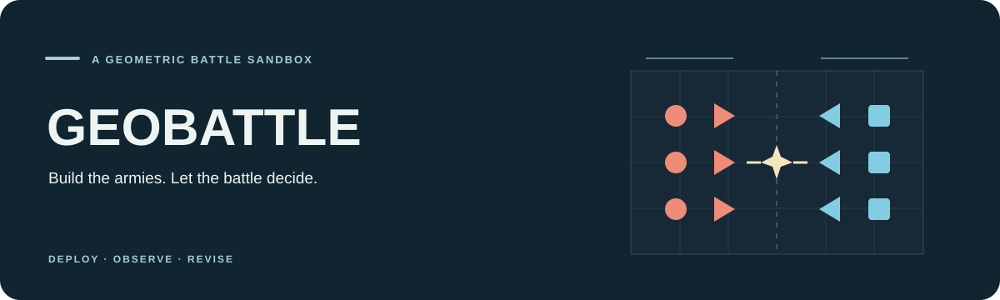
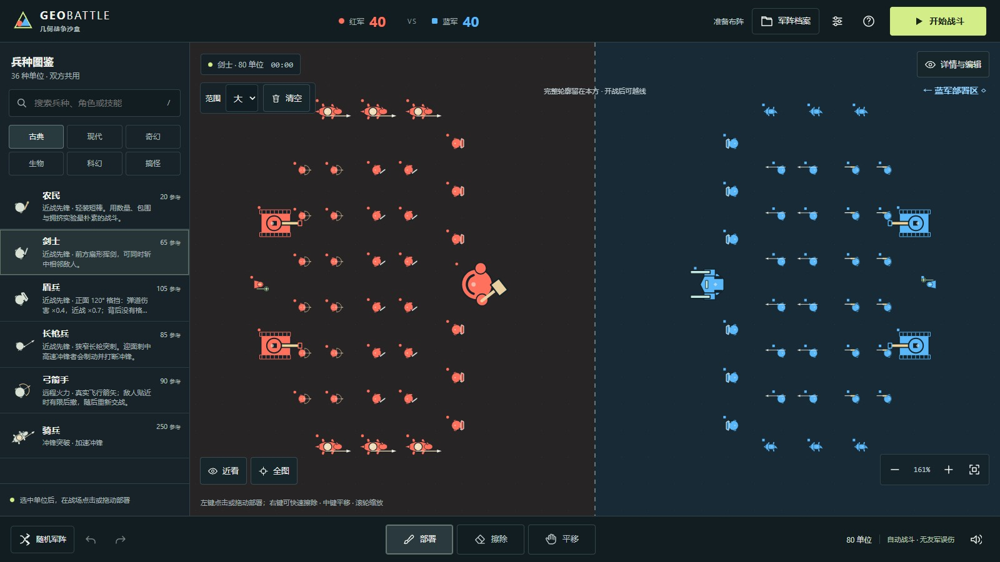
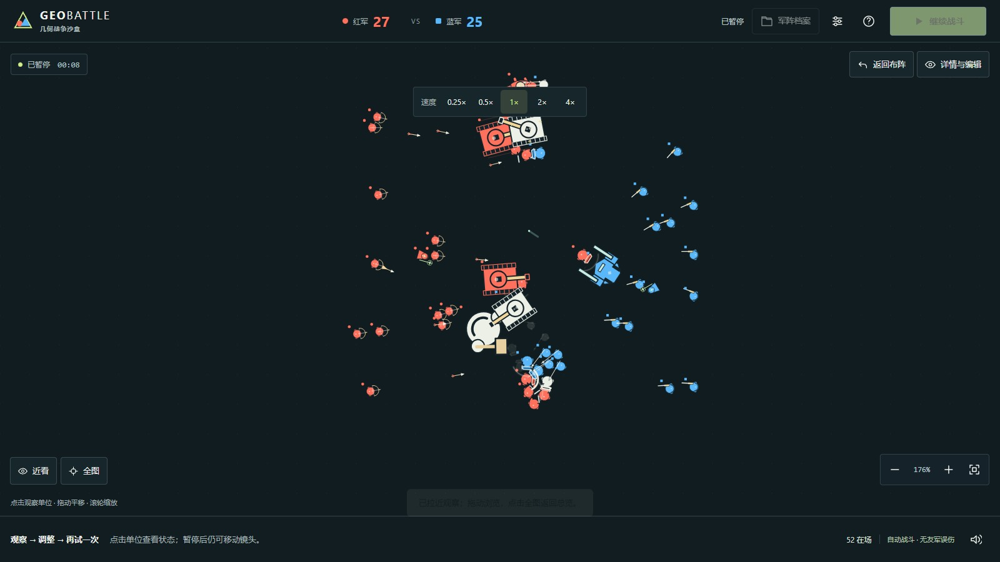

  

<h1 align="center">⚔️ GEOBATTLE</h1>

  <strong>Build the armies. Let the battle decide.</strong>

  A geometric battle sandbox where you place both sides, start the simulation, 
  and discover what happens when strategy meets autonomous combat.

  <a href="https://seiya058904.github.io/GEOMETRIC-BATTLE-SANDBOX/"><strong>▶ Play in Your Browser</strong></a>
  &nbsp;·&nbsp;
  <a href="GEOBATTLE-OFFLINE.html">⬇ Standalone Offline Game</a>
  &nbsp;·&nbsp;
  <a href="#build-fight-repeat">🎮 How It Works</a>
  &nbsp;·&nbsp;
  <a href="#run-from-source">⚙️ Development</a>

  36 UNIT TYPES &nbsp;·&nbsp; TWO ARMIES &nbsp;·&nbsp; AUTOMATED COMBAT &nbsp;·&nbsp; SEEDED REPLAYS &nbsp;·&nbsp; OFFLINE READY

  
   
  Real Chromium capture of the default formation: 40 red and 40 blue units. Not concept art.

---

> **The experiment is yours. The result belongs to the battlefield.**
>
> There are no coins to grind and no units to unlock. Place swordsmen, archers, tanks, dragons, and stranger combatants wherever your side is allowed to deploy. Press start and watch them find targets, attack, use skills, and collide. Then change the arrangement and try again.

## 🎮 Build. Fight. Repeat.

<code>CHOOSE UNITS &nbsp;→&nbsp; DEPLOY BOTH ARMIES &nbsp;→&nbsp; WATCH THE BATTLE &nbsp;→&nbsp; REVISE &amp; RETRY</code>

1. **Build the matchup.** Choose from 36 predefined units across historical, modern, fantasy, creature, sci-fi, and playful categories. Both teams draw from the same roster.
2. **Shape the formation.** Click or drag to deploy, paint a wider area with the brush-size control, or open advanced tools for lines, grids, selections, rotation, copying, and mirroring.
3. **Start the simulation.** Units independently move, acquire targets, fight, heal, use abilities, or summon reinforcements according to their rules.
4. **Study the outcome.** Pause, zoom in, inspect a unit, review losses and contributions, and return to the untouched pre-battle formation to make your next change.

## ✨ A Sandbox for "What If?"

<table>
  <tr>
    <td width="50%" valign="top">
      <h3>🧩 Formation Editing</h3>
      
Place and erase individual units or larger groups. Brush strokes, clearing, selection operations, undo, and redo make rearranging an experiment quick.

    </td>
    <td width="50%" valign="top">
      <h3>🤖 Autonomous Combat</h3>
      
Watch melee, projectiles, skills, control effects, healing, and summons resolve in a deterministic, fixed-step simulation.

    </td>
  </tr>
  <tr>
    <td width="50%" valign="top">
      <h3>🎲 Reproducible Matchups</h3>
      
Replay an unchanged formation with the same random seed, or use a new seed to see how another encounter unfolds. Cross-platform bit-for-bit identity is not promised.

    </td>
    <td width="50%" valign="top">
      <h3>📊 Battle Reports</h3>
      
Compare casualties, damage, healing, and unit contributions, including the two most recent battles in your current session. Reports provide evidence, not automatic explanations of causality.

    </td>
  </tr>
  <tr>
    <td width="50%" valign="top">
      <h3>🗂️ Saved Formations</h3>
      
Use ready-made experiments, named presets, browser persistence, and JSON import/export to preserve or share arrangements.

    </td>
    <td width="50%" valign="top">
      <h3>📦 A Standalone Offline Edition</h3>
      
The packaged single HTML includes its gameplay code and styles. Canvas 2D draws the battlefield; Web Audio synthesizes sound without a runtime CDN.

    </td>
  </tr>
</table>

## 🖼️ Watch the Battle Unfold

  
   
  An actual battle paused after approximately eight seconds of simulation, not a promotional render.

A good matchup can be examined from different distances. Use close inspection for weapons and abilities, an overview for the formation as a whole, or a speed setting between **0.25× and 4×** to follow the fight.

The preset formation library includes three paired experiments—shield orientation, spear-line offsets, and dense versus spread deployments—providing six starting points for comparison.

## 🚀 Play Online or Offline

**[Open GEOBATTLE in your browser →](https://seiya058904.github.io/GEOMETRIC-BATTLE-SANDBOX/)**

The default battlefield begins with **40 units per side**. You can fight immediately or make your own composition first. Each team needs at least one unit before a battle can start.

**[Get the standalone offline HTML →](GEOBATTLE-OFFLINE.html)**

Open the file link above, choose **Download raw file** on GitHub, and save `GEOBATTLE-OFFLINE.html` to your computer. Then open the downloaded file in a modern browser. This packaged file is the offline game; the development `index.html` is not a drop-in standalone export. No account, installation, or live game server is needed.

### ⌨️ Controls at a Glance

| Action | Input |
| :--- | :--- |
| Deploy / erase | Left-click or drag to place; right-drag to erase; brush-size controls change the area |
| Pan / zoom | Middle-drag or Alt-drag to pan; mouse wheel to zoom |
| Undo / redo | `Ctrl+Z` / `Ctrl+Y` or `Ctrl+Shift+Z` |
| Start / pause / resume | `Space` |
| Switch editing tools | `B` deploy, `E` erase, `V` select, `L` line, `R` grid |
| Find units / fit the view | `/` for search, `F` to fit the armies |
| Cancel / close | `Esc` |
| Touchscreen | One finger for the selected tool; two fingers to pan or zoom |

On macOS, Command can replace Ctrl where appropriate. Shortcuts do not pass through focused text inputs, dialogs, or modal panels.

Units must initially be placed inside their team's deployment half and may not overlap or extend out of bounds. Once combat starts, they can freely cross the center line. Editing is locked during combat; returning to the editor restores the original pre-battle deployment.

## 💾 Local Saves & Performance Boundaries

Formation data belongs to the current **browser and site origin**, not to a cloud account. The hosted site and a locally opened file do not automatically share it; use JSON export/import for backup or transfer.

Use **one editing tab at a time** for the same site. An older open tab can overwrite the shared autosave with its own formation; cross-tab conflict protection is not implemented. Export important formations as JSON before switching sessions.

This is a **single-player spectator sandbox**, not a multiplayer game, campaign, economy simulator, or general-purpose rigid-body physics engine. The **1,200 active-unit cap** includes summons and is a safety limit, **not** a promise of smooth performance at that scale. Very large formations can cause substantial frame-time spikes; lowering quality or using fewer units may help. Thirty-six units are provided for experimentation, not claimed to be competitively balanced.

## 🛠️ Run from Source

**JavaScript ES Modules · JSDoc · Canvas 2D · Web Audio · esbuild**

Requires **Node.js 22+** (the Pages workflow uses Node 24). From the repository root:

~~~bash
npm ci
npm run dev
~~~

Open **http://127.0.0.1:4178/**. The local development server requires a manual refresh after source edits. Stop it with `Ctrl+C` before running the checks and production preview below; both servers use port 4178 by default.

~~~bash
npm run check
npm test
npm run build
npm run preview
~~~

The production build produces the `dist/` site and the standalone offline HTML.

<strong>Browser checks, repository map, and publishing</strong>

Browser checks require a separately available Playwright module and compatible Chromium binary. Set `PLAYWRIGHT_MODULE` and optionally `PLAYWRIGHT_EXECUTABLE` as required by your environment.

~~~bash
node tests/browser.mjs
node tests/v3-browser.mjs
node tests/bulk-editor.mjs
node tests/offline.mjs
~~~

For targeted runs, `GEOBATTLE_TEST_DIST=1` selects the production build, `GEOBATTLE_TEST_URL` chooses a test server, and `GEOBATTLE_EVIDENCE` redirects evidence output.

| Path | What it contains |
| :--- | :--- |
| `src/data/` · `src/sim/` | Unit definitions, fixed-step combat, AI, and seeded randomness |
| `src/editor/` · `src/persistence/` | Placement rules, undo history, and formation saves |
| `src/render/` · `src/ui/` | Procedural visuals, sound, interactions, and reports |
| `tests/` · `scripts/` | Regression tests, builds, and distribution checks |
| `docs/` | Product guidance, verification, performance, and release records |

The Pages workflow verifies source and distribution artifacts before publishing. Browser acceptance performed locally or against the deployed site should not be confused with CI tests that do not have those browser dependencies.

**Further reading:** [Unit roster](docs/UNIT-ROSTER.md) · [Design decisions](docs/GAME-DESIGN.md) · [Public release record](docs/PUBLIC-CLOSEOUT.md) · [Performance investigation](docs/V2-PERFORMANCE-INVESTIGATION.md).

## 📜 Status, Credits & Rights

Windows Chromium testing covers desktop layouts and simulated touch environments. **Physical Android/iOS devices, Firefox, Safari, and subjective audio quality have not been fully validated**. Historical performance investigations include severe long frames and do not establish a universal 60 FPS guarantee. See the [quality record](docs/QUALITY-ITERATION.md) for evidence and known limits.

Gameplay units, effects, and scenery are drawn by code; the sound is synthesized. Images under `design/` are concept references and are not included as gameplay assets. The two screenshots on this page are actual browser captures.

**No project-wide license is declared.** Source visibility and the ability to play do not grant unrestricted rights to copy, modify, or redistribute game code or assets. Third-party development dependencies retain their own applicable licenses.

<strong>Historical local evidence and delivery packages</strong>

Browser screenshots, traces, and acceptance artifacts are normally generated under the Git-ignored `evidence/` directory. On 2026-10-13, local historical evidence and three delivery ZIPs were recycled while the game source and current offline distribution were preserved. Earlier committed evidence may remain in Git history; historical manifests describe their original packages, not a guaranteed current working-tree inventory.

---

  BUILD THE ARMY. WATCH THE OUTCOME. CHANGE ONE THING. TRY AGAIN. 
  GEOBATTLE · A geometric sandbox for battles worth testing twice.

