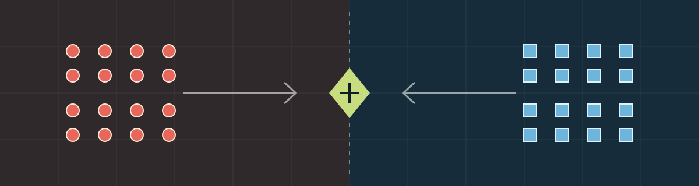
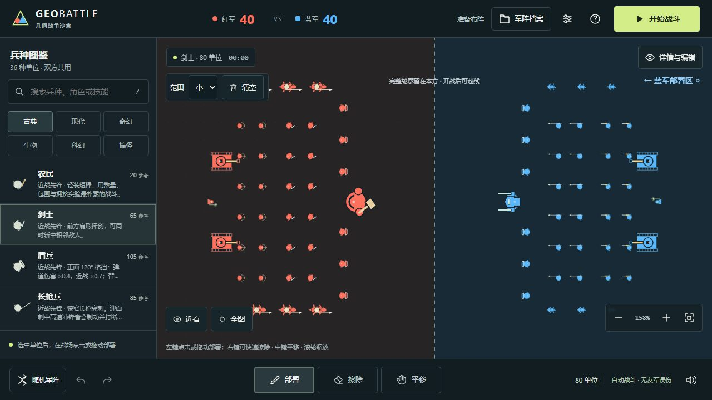

# GEOBATTLE

A single-player battle sandbox: arrange two armies, start the simulation, and watch autonomous units fight. The game interface is in Simplified Chinese.

[Play online](https://seiya058904.github.io/GEOMETRIC-BATTLE-SANDBOX/) · [Standalone offline edition](GEOBATTLE-OFFLINE.html) · [Run from source](#run-from-source)

*Original battlefield illustration, not a screenshot.*

## Features

- **Build both sides:** choose from 36 unit types and place, erase, select, copy, rotate, or mirror formations.
- **Watch autonomous combat:** units move, find targets, attack, heal, use abilities, and summon according to their rules.
- **Compare seeded matchups:** rerun an unchanged formation with the same seed, or choose a new seed; cross-platform bit-for-bit identity is not promised.
- **Read battle reports:** inspect losses, damage, healing, and unit contributions, with the two latest battle snapshots retained for the current session.
- **Save an experiment:** use presets, browser storage, and JSON import/export to preserve or share formations.
- **Play offline:** the packaged single HTML contains gameplay code and styles; Canvas 2D and synthesized Web Audio run without a runtime CDN.



*Actual Chromium capture of the local development version.*

## How to play

1. Choose a unit and place it in its team's half. Use the brush or advanced line, grid, selection, and mirror tools to shape a formation.
2. Give each side at least one unit, then start the battle. Units can cross the center line once combat begins.
3. Pause, adjust speed, zoom, or inspect units while the simulation runs. Review the report when the battle ends.
4. Return to the editor to restore the pre-battle formation, change one variable, and try again.

The default example starts with 40 units on each side. The preset library includes paired formation experiments; their outcomes are not guaranteed. Reports describe results rather than proving why one side won.

## Controls

| Input | Action |
| --- | --- |
| Left click or drag | Deploy; use the brush-size control for a wider area |
| Right drag | Erase |
| Middle drag or Alt-drag; mouse wheel | Pan; zoom |
| `Space` | Start, pause, or resume |
| `B`, `E`, `V`, `L`, `R` | Deploy, erase, select, line, and grid tools |
| `Ctrl+Z`, `Ctrl+Y` | Undo, redo (`Ctrl+Shift+Z` also redoes) |
| `/`, `F`, `Esc` | Search, fit armies, cancel or close |
| One finger; two fingers | Use the selected tool; pan or zoom |

On macOS, Command can replace Ctrl where appropriate. Shortcuts do not pass through focused text inputs or modal panels.

## Play offline and protect saves

Download [`GEOBATTLE-OFFLINE.html`](GEOBATTLE-OFFLINE.html) from the repository using GitHub's raw-file download, save it, and open it in a modern browser. The development `index.html` is not a standalone export. No account or game server is required.

Formations belong to the current browser and site origin. Export JSON before clearing site data or moving between the hosted and local editions. **An older tab on the same origin can overwrite a newer autosave**; avoid editing the same formation in multiple tabs and keep an exported backup.

The 1,200 active-unit limit includes summons and is a safety cap, not a smooth-performance guarantee. Large battles may produce long frames. This is a spectator sandbox, not a multiplayer game, campaign, economy simulator, or general-purpose physics engine. Physical Android/iOS devices, Firefox, Safari, and subjective audio quality have not been fully validated.

## Run from source

**Prerequisites:** Node.js 22 or newer and npm.

```sh
npm ci
npm run dev
```

Open `http://127.0.0.1:4178/`. Refresh manually after source edits. To check and build:

```sh
npm run check
npm test
npm run build
npm run preview
```

The build produces `dist/` and the standalone HTML. Browser checks require an available Playwright module and compatible Chromium; set `PLAYWRIGHT_MODULE` and, if needed, `PLAYWRIGHT_EXECUTABLE` for the local environment. `npm run test:browser` and `npm run test:offline` are available for those checks. CI verification is not a substitute for browser or physical-device acceptance.

## Project map

- [`src/data/`](src/data/) and [`src/sim/`](src/sim/) — unit definitions, fixed-step combat, AI, and seeded randomness.
- [`src/editor/`](src/editor/) and [`src/persistence/`](src/persistence/) — placement, editing history, and formation saves.
- [`src/render/`](src/render/) and [`src/ui/`](src/ui/) — procedural visuals, sound, controls, and reports.
- [`tests/`](tests/) and [`scripts/`](scripts/) — regression checks, builds, and distribution tools.

See the [unit roster](docs/UNIT-ROSTER.md), [design decisions](docs/GAME-DESIGN.md), [quality record](docs/QUALITY-ITERATION.md), and [performance investigation](docs/V2-PERFORMANCE-INVESTIGATION.md). Historical evidence and delivery manifests describe their recorded versions, not necessarily files still present in the working tree.

## Rights and attribution

Units, effects, and scenery are drawn in code; sound is synthesized. Images under `design/` are concept references, not gameplay assets. No project-wide license is declared: source visibility and play access do not grant unrestricted permission to copy, modify, or redistribute the game. Development dependencies retain their own applicable licenses.
