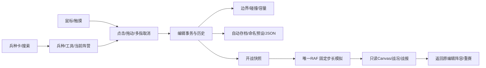

# V2 接入基线与审计

2026-10-13（Asia/Shanghai）。原 HEAD/main/origin/main 均为 `924150f922e5da2cff1000aa5bb034fb34b32701`；`git ls-remote` 已复核。接入工作树干净，无 stash，只有主工作树；原 v1 ZIP 保留。任务分支 `codex/geobattle-v2`，只授权本地提交和打包。

## 真实基线

- `npm run check` 退出 0；`npm test` 195/195 通过，0 跳过。
- 原源码浏览器：60/60 场景、25/25 截图；原生产：7/7、3/3 截图；断网单 HTML 三检查通过。原始数据在 `evidence/v2/baseline/`，原源码快照 `evidence/v2/baseline-source.zip`。
- Windows 无头 Chromium 151.0.7922.34，既有 harness 强制 SwiftShader，DPR1。不是实体 GPU/实体安卓验收。使用已有 Playwright，因为当前无 Browser 插件；不安装额外产品依赖。
- 六视口：320×568、375×812、768×1024、1366×768、1920×1080、3840×2160。截图编号由 JSON screenshots 字段索引，名称 `browser-尺寸-initial/deployment/result.png`；另包含真实暂停、混合部署、观察焦点与预设转义截图。4K 是模拟视口。
- 性能同条件七场景×三轮，由独立静态快照运行；原始数据和失败控制实验写入 `evidence/v2/`，最终解释见性能报告。测量期间不并行运行其他浏览器。

## 操作与数据流

V1 输入：single、brush、line、grid、select、erase、pan 七模式，paste 为独立残留状态；触摸单击等松手，双指取消事务。V2 将默认部署与擦除、相机、高级选择明确分层；手势锁队，取消回滚，领域层统一校验，持久化只在明确恢复入口处理历史跨区。

## CONFIRMED-RUNTIME

1. **部署队伍依赖工具栏状态（V2 P0）**：基线 `free-deployment-allows-a-red-unit-on-the-right-half` 成功；选红后右侧仍产生红军。V1 允许的行为，不冒称随机 Bug。V2 期望位置决定队伍且主体不跨线。根因 editor/placement 只验世界/碰撞，input 传 app.team；专门新增 home-zone 和输入回归。
2. **新手同兵两方需要额外选队（P1 UX）**：基线 choose() 必须先点 team，再选类别/兵。红蓝在顶栏与目录重复。策略：人数成为信息，统一中性兵种库。
3. **删除和选择受队伍过滤（P1 UX/静态交叉证据）**：eraseAt/selectRect 传 app.team，右键用于平移；右删两侧不是现有操作。策略：右键命中直接删，默认点实体选择、空白绘制；高级框选可混合两军。

## CONFIRMED-STATIC

- swapTeams 仅改 team；mirrorAll 仅改 x。新半场不变量下均非法；必须同步 x/team/angle 并原子校验。
- pasteAt 显式队伍、moveSelection 保留原队伍；必须按完整组目标区域确定/拒绝，不半提交。
- V1 导入允许跨区。不能简单启用 strict 后丢弃旧预设；保留原 raw、只读预览、创建兼容副本后才可开战，取消不解除自动存档保护。
- Canvas 半区只有 .021 透明度且叫建议区；高级 facing/spacing/seed 默认暴露；核心文字过小。策略强化半区和禁放幽灵、按需高级面板。
- 旧三项修复在当前源码存在且浏览器通过：角色搜索、换兵取消粘贴、战中 follow/deselect 焦点保留；纳入 V2 回归。

## NEEDS-VERIFICATION

主 Canvas CPU 回读、软件合成、反复网格重建都是性能候选，不能从源码证明低 FPS 根因；frame 的 .1s elapsed 截断在长帧时会损失模拟墙钟时间，需如实报告。不得修改战斗数值、固定步长、人数上限来美化指标。

## 产品取舍

保留全部36兵种、自动战斗、确定性、离线、1200保护上限、预设/JSON/撤销/矩阵/旋转/复制/镜像。高级阵型与细项收进按需入口；合并single/brush默认动作；取消可绕过半场的freeDeploy与隐式队伍工具。手机采用显式部署/擦除/平移，双指始终优先。无真实新手招募，自测不是用户研究。

## 迭代中复现并修复

- P1：恢复对话框备份空字符串时被默认JSON代替；用null合并保留精确raw，E2E检查实际下载字节。
- P1：待粘贴时右键仍提交/忽略擦除；右键优先身体命中擦除，剪贴板保留。
- P1：高级面板/抽屉会遮挡移动、粘贴与返回入口；操作进入时关闭抽屉，上下文面板避开HUD。
- P1：选中既有单位时详情仍显示当前画笔兵种；面板以真实实体类型、阵营与ID显示，另有明确的同类部署入口。
- P1：重复打开确认对话框时，排队的旧close事件可清掉新确认回调；close处理在对话框已重新open时退出。完整导出→清空→导入旅程此前失败，修复后重跑通过。失败原始报告在pre-final-fix/browser-all.json。
- P2：红半区标签被人数HUD遮挡；标签移至HUD下方，独立四视口单项复审通过（visual-review-final.md），不冒称完整审美认证。
- 新高级朝向预览与落点曾忽略偏转：统一传入朝向，单测覆盖。既有角色搜索扩展到类别/技能，中文检索保留。

基线流程图描述的是V1；最终V2状态流和按落点分队以V2-UX-AND-INTERACTION.md为准。软件300v300长帧、硬件1200人帧率未达及未执行项目保留在性能与QA报告，不以设计修复掩盖。
