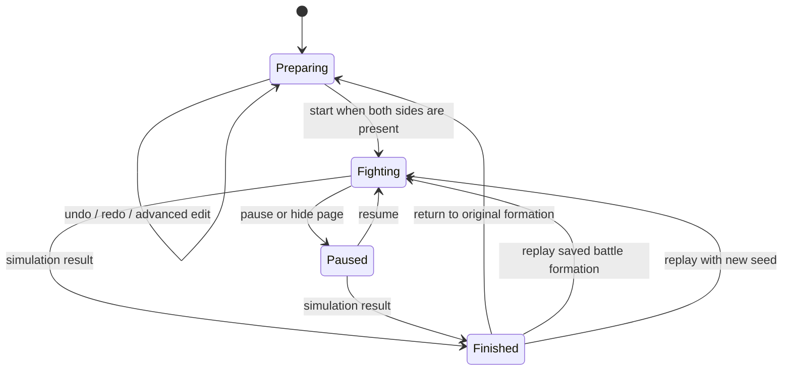

# GEOBATTLE V2 UX and interaction

## Default path

The first screen opens on the example armies with the battlefield visible, a shared neutral 36-unit catalog, both side counts, and a prominent **开始战斗** button. The player selects one unit and uses the same deployment mode on either side. Position sets the initial team. A desktop player can add with left click or a left-button drag, correct a mistake with right click, and start the simulation. A phone player selects a visible Deploy, Erase, or Pan mode before using one finger.

The unit catalog is one identity per type. Search covers unit name, role, description, and skill; category filters remain available. Selecting a unit closes the phone drawer and returns the player to the battlefield. The selected unit’s icon in the catalog is neutral; the battlefield preview communicates the resulting side and placement validity.

## Layout and surfaces

- **Header:** GEOBATTLE identity, non-interactive red and blue counts, preparation/battle state, presets, settings, help, and the primary start/pause/report action.
- **Desktop workspace:** a compact left catalog and the main battlefield. The canvas receives the remaining width. Unit details are hidden until requested.
- **Context overlay:** the selected unit’s identity, role, short description, key stats, and a direct “开始部署” action. A collapsed “高级编辑与军阵设置” section contains facing, spacing, select/move, copy/paste, delete, rotate, mirror, clear-side, clear-all, whole-field mirror, and seed controls.
- **Selection context:** when units are selected, show their count and immediate copy, delete, and mirror actions above the unit information. The expanded advanced section also offers selecting either side, line/matrix tools, and a position-aware “对调两军” action.
- **Battlefield overlay:** phase, elapsed time, pause/return controls, speed choices, and camera controls. The right detail overlay can show live unit health, target, state, cooldowns, and contribution without taking the field away.
- **Footer:** three task modes—Deploy, Erase, and Pan—plus undo/redo, random formation, unit count, and sound.
- **Phone:** a single-stage canvas, top counts and primary action, bottom three-mode control bar, and a catalog drawer. The contextual detail panel uses the same drawer-sized overlay. Interactive targets are at least 44px tall.
- **Results:** the report presents winner/draw and reason first, both teams’ totals next, standout damage/kills next, and a disclosure for per-unit records. Return, same-seed replay, and new-seed replay stay distinct actions.

## Input rules

### Desktop

| Intent | Action |
| --- | --- |
| Choose a unit | Select one card in the catalog; the default mode remains Deploy. |
| Deploy | Left click adds one unit; left drag paints a continuous group. A gesture keeps its starting side and cannot silently deploy across the center. |
| Determine side | The complete unit body and safety gap must fit inside the red or blue deployment half. The center band and invalid locations show a blocked preview and reason. |
| Erase | Right click removes the unit under the pointer; right drag erases continuously. The player does not need to select a team first. |
| Change mode | The bottom Deploy, Erase, or Pan controls change the active pointer mode. Pan drag moves the camera. |
| Camera | Wheel zooms at the pointer; middle-button drag pans; the fit and full-view buttons reset framing. |
| Undo / redo | One drag is one history operation. Undo and redo remain in the footer. |
| Battle | Start, pause/resume, speed, click-to-inspect, follow, return, and report use visible controls. Combat remains autonomous. |

Advanced straight-line, matrix, and selection tools appear in the expanded detail overlay. Side selection and clearing name red or blue explicitly. Copy, move, mirror, swap, import, and load paths must preserve the same initial-zone checks owned by the editor rules.

### Phone

1. Open the unit drawer and select a unit. Selection returns to the battlefield.
2. Choose one of the always-visible Deploy, Erase, or Pan modes.
3. Use one finger for the chosen mode. A second finger switches the gesture to camera pan/zoom and cancels the pending edit.
4. Undo through the visible footer, then use the header’s start button when ready.

The phone interface never depends on a right mouse button or hover state. The canvas keeps pointer input disabled at the browser level so gestures are interpreted consistently by the game.

## State transitions

Selection, drawers, and overlays are presentation state. Closing a drawer or cancelling a pointer gesture cannot commit a partial edit. Starting combat ends edit gestures and snapshots the formation; return restores that formation for further editing.

## UI hooks

The shell keeps the stable selectors consumed by the controller and browser flows: `#catalog`, `#categories`, `#unit-search`, `#catalog-list`, `#battlefield`, `#red-count`, `#blue-count`, `#start-button`, `#undo-button`, `#redo-button`, `#formation-count`, `#playback`, `#inspector`, `#inspector-content`, and `#dialog`.

The main toolbar emits `data-tool="brush|erase|pan"` alongside `data-action="tool-brush|tool-erase|tool-pan"`. Advanced buttons expose `tool-select`, `tool-line`, and `tool-grid`; side selection and clearing use `select-red|select-blue` and `clear-red|clear-blue` actions. Unit and category entries retain `data-action="unit" data-type="…"` and `data-action="category" data-category="…"`. No visual control writes a hidden current-team state. The inspector is hidden by default and opens through `inspector-toggle`. Catalog refreshes patch selected/disabled states while the visible result set remains unchanged, preserving focused unit controls. On battle detail refresh, observation buttons keep stable DOM nodes so focus and keyboard activation survive live stat updates.

When an autosave is being held for recovery, the presets dialog exposes a visible recovery action and explains that the original remains protected until the player chooses how to proceed.

## Accessibility and feedback

- Counts are read-only information and are not focusable as team controls.
- The active toolbar mode exposes `aria-pressed`; catalog type selection exposes `aria-pressed`; buttons retain visible keyboard focus.
- Invalid placement must be visible in the pointer preview and announced as concise feedback after a rejected action.
- Search remains a native search input and matches Chinese names, role labels, skill text, and stable unit IDs.
- Reduced motion disables nonessential transitions. Battle state and result are stated in text, not communicated only through color.
- Panel scroll areas remain independent from the page and keep reachable close buttons.

## Product-level acceptance points

- From the initial screen, the same catalog type can be placed on each side without an intervening team control.
- A mistaken unit can be erased directly on either side; one completed drag is one undo step.
- Invalid midline, overlap, outside-world, and capacity placements are rejected consistently by the preview and editor.
- Phone deployment, erase, and pan are explicit modes with visible touch targets; pinch cancels any pending edit.
- Battle observation and report controls remain clear without covering the central encounter.
